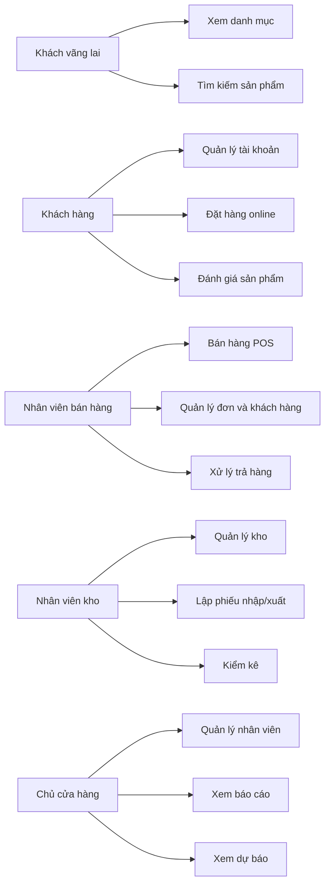

# Tài liệu Use Case

## Tác nhân

| Tác nhân | Quyền chính |
|---|---|
| Khách vãng lai | Xem danh mục, tìm kiếm, lọc, xem chi tiết và đánh giá công khai |
| Khách hàng | Đăng ký, đăng nhập, hồ sơ, địa chỉ, yêu thích, đánh giá và đặt hàng |
| Nhân viên bán hàng | POS, khách hàng, khuyến mãi, đơn hàng, trạng thái giao hàng và báo cáo bán hàng |
| Nhân viên kho | Sản phẩm, danh mục, nhà cung cấp, nhập/xuất/kiểm kê, tồn kho và trả hàng |
| Chủ cửa hàng | Nhân viên, chi phí, lịch sử thao tác, báo cáo, xuất Excel và dự báo |

## Use Case tổng quát

## Use Case chi tiết

### UC-01: Đăng nhập

- Tác nhân: tất cả tài khoản
- Tiền điều kiện: tài khoản tồn tại
- Luồng chính: nhập tên đăng nhập/mật khẩu -> máy chủ xác thực JWT -> chuyển giao diện theo role
- Luồng thay thế: sai tài khoản hoặc mật khẩu -> trả thông báo lỗi, không cấp token

### UC-02: Bán hàng POS

- Tác nhân: nhân viên bán hàng
- Tiền điều kiện: đăng nhập role `SALES`
- Luồng chính: chọn khách hàng và sản phẩm -> quét mã hoặc nhập số lượng -> áp dụng khuyến mãi -> xác nhận thanh toán -> trừ tồn -> ghi giao dịch
- Luồng thay thế: tồn kho không đủ hoặc sản phẩm quá hạn -> thông báo và không tạo đơn

### UC-03: Đặt hàng online

- Tác nhân: khách hàng
- Tiền điều kiện: đã đăng nhập, giỏ hàng hợp lệ
- Luồng chính: chọn địa chỉ -> chọn COD hoặc cổng thanh toán -> máy chủ kiểm tra giá, tồn và khuyến mãi -> tạo đơn -> giữ tồn
- Luồng thay thế: COD giữ tồn chờ xác nhận; cổng online cần callback/IPN hợp lệ mới chuyển sang đã thanh toán

### UC-04: Hủy đơn

- Tác nhân: khách hàng
- Điều kiện: đơn trạng thái trước giao
- Luồng chính: gửi yêu cầu hủy -> máy chủ kiểm tra trạng thái -> hoàn tồn và ghi sổ biến động -> đổi trạng thái `CANCELLED`

### UC-05: Nhập hàng

- Tác nhân: nhân viên kho
- Luồng chính: chọn nhà cung cấp, sản phẩm và giá nhập -> lưu phiếu `DRAFT` -> xác nhận phiếu -> cộng tồn trong transaction -> ghi sổ biến động
- Luồng thay thế: phiếu đã xác nhận -> không cho xác nhận lại

### UC-06: Xuất/kiểm kê kho

- Tác nhân: nhân viên kho
- Luồng chính: ghi phiếu xuất hoặc điều chỉnh tồn -> máy chủ kiểm tra số lượng -> cập nhật tồn -> ghi biến động
- Luồng thay thế: không cho tồn kho âm

### UC-07: Trả hàng

- Tác nhân: khách hàng tạo yêu cầu; nhân viên duyệt và nhận hàng
- Luồng chính: khách yêu cầu trong thời hạn -> nhân viên duyệt -> nhân viên xác nhận nhận hàng -> nhập lại kho -> xác nhận hoàn tiền thủ công
- Luồng thay thế: nhân viên từ chối hoặc chưa đủ điều kiện -> giữ nguyên trạng thái phù hợp

### UC-08: Báo cáo và dự báo

- Tác nhân: chủ cửa hàng
- Luồng chính: chọn khoảng thời gian -> tổng hợp doanh thu, chi phí, mặt hàng và nhân viên -> xuất Excel hoặc xem dự báo
- Quy tắc: doanh thu sản phẩm tính theo đơn hàng đã thanh toán và sau giảm giá; đơn hoàn tiền không tính doanh thu/giá vốn
